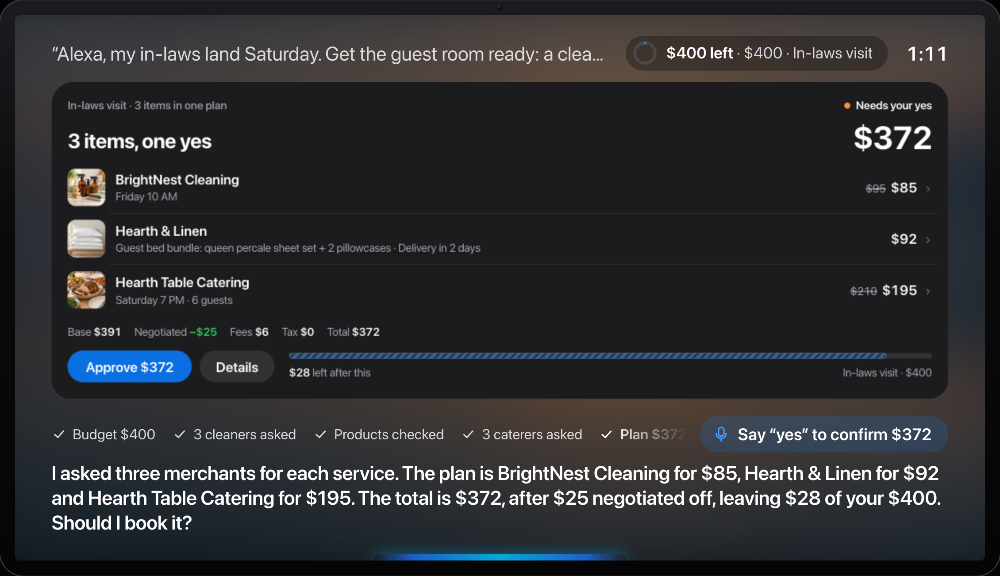
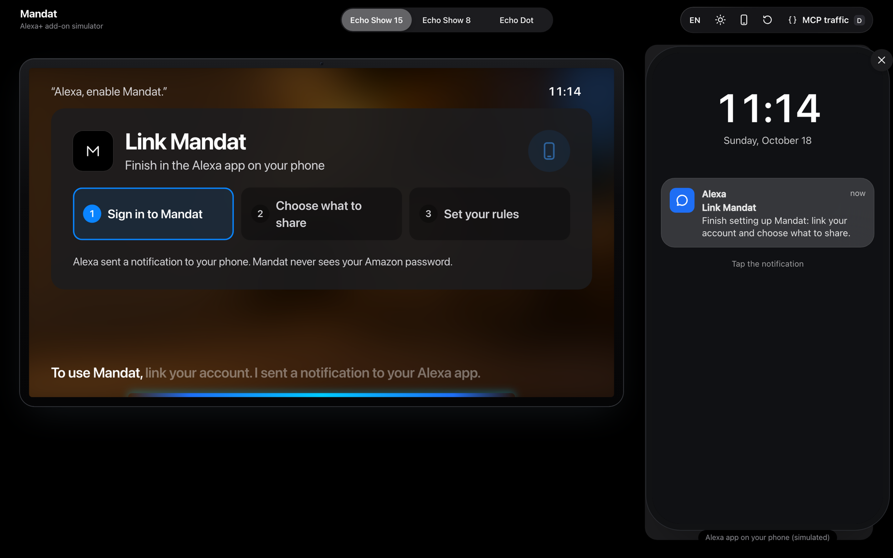
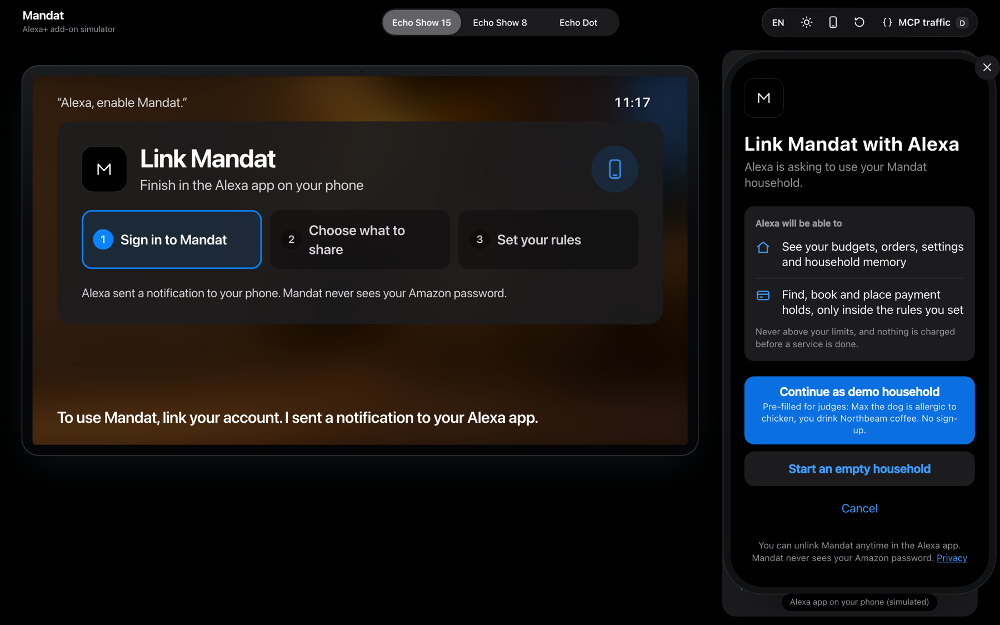
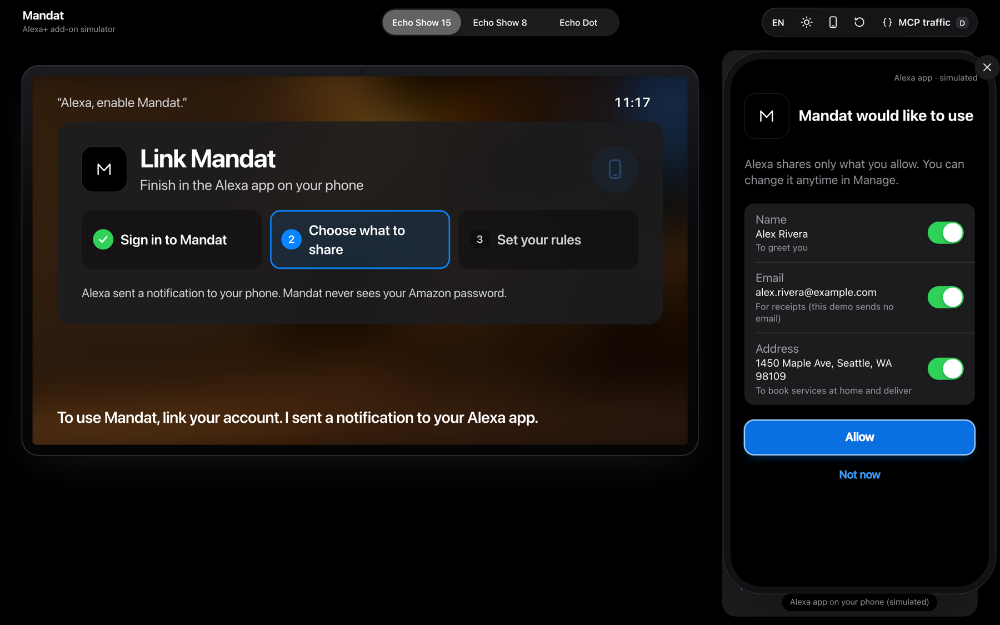
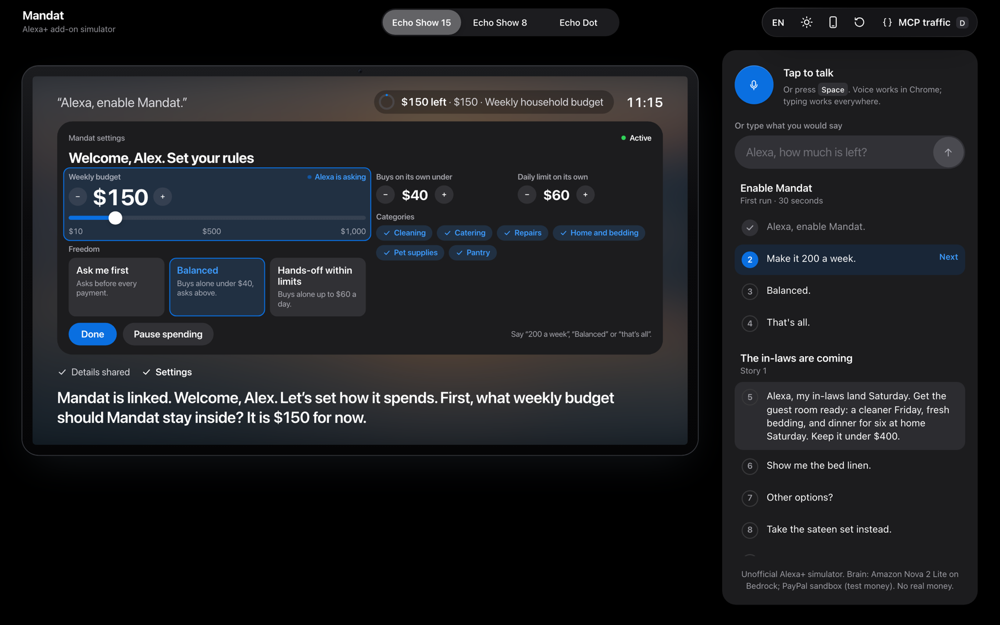
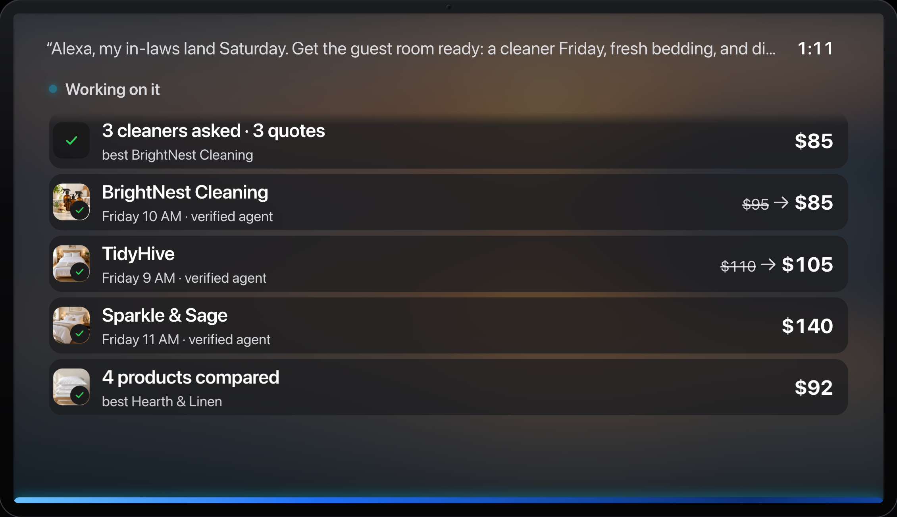
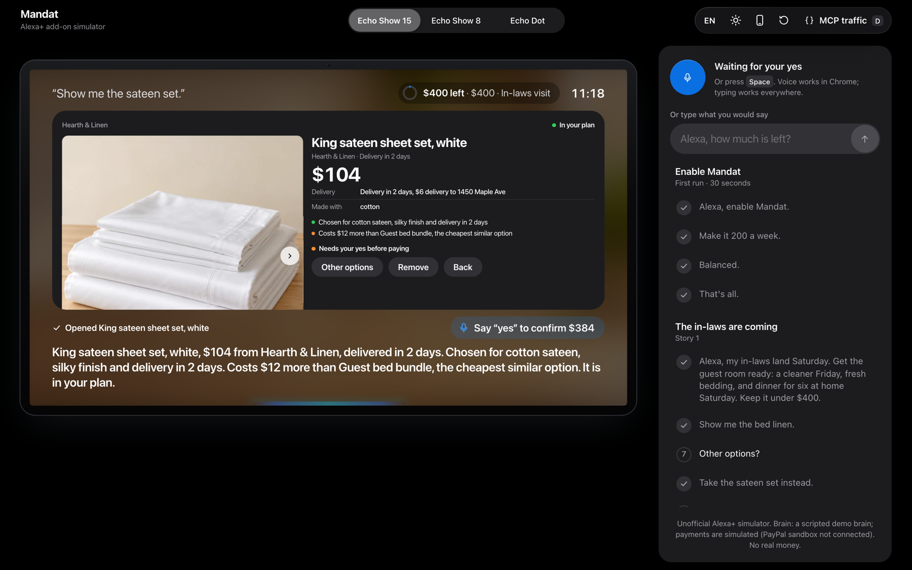
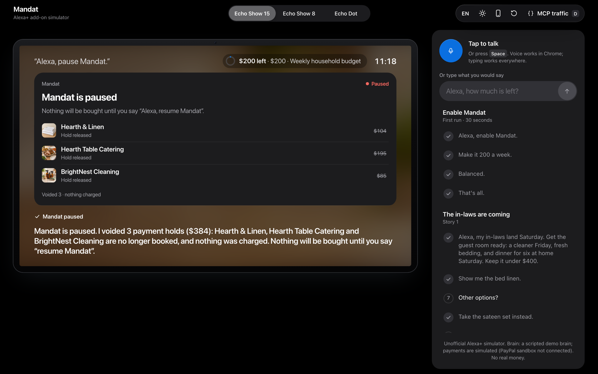
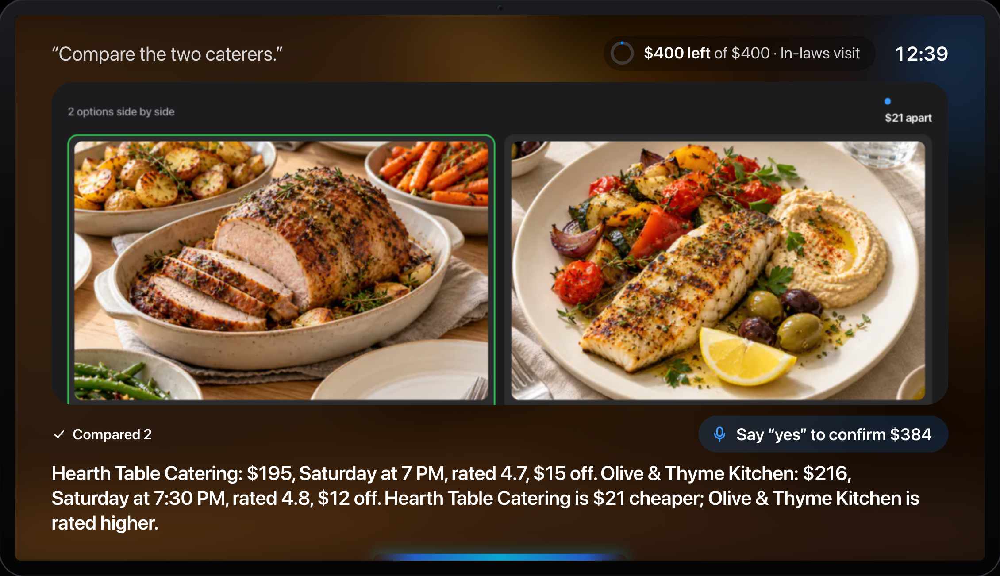

# Mandat for Alexa+

**Give Alexa a budget, not a to-do list.**

Mandat is an Alexa+ add-on for household errands. You set a budget once ("keep it under $400",
"$150 a week, buy on your own under $40"). Mandat asks local merchants' AI agents for quotes in parallel, negotiates,
builds one plan, asks for your yes, places payment holds instead of charging, and remembers the household from one
session to the next. When plans change, it moves, voids, captures less or refunds.

> Hackathon entry for Amazon "Build, Ship, Shape": Alexa+ track, AWS Builder mini-challenge.
> Unofficial Alexa+ simulator. No real money moves. PayPal **sandbox** (test money): holds, captures, voids and refunds
> are real sandbox transactions once the owner has linked the demo's sandbox buyer; until then they are simulated, and
> every card and the page footer say which. Judges never need a PayPal account.

## Try it in 2 minutes (judges)

**Live on AWS:** https://fonzkp2f5pszfit6xmqqiw7qdm0dybyu.lambda-url.us-east-1.on.aws/simulator/

1. Open the link in Chrome (desktop). Nothing to install, **no sign-up**.
2. **Enable Mandat (30 s).** Click the first line of the demo script, *"Alexa, enable Mandat."* Exactly like Alexa+,
   the page calls a Mandat tool, gets **HTTP 401**, reads the OAuth metadata and opens the **Alexa app** (simulated, on
   a phone beside the Echo Show). Tap the notification → **Link account** → on Mandat's own page tap **Continue as demo
   household** (pre-filled for judges) → choose what Alexa shares (**name, email, address**, one switch each) →
   **Allow**. That is a real OAuth 2.1 authorization code + PKCE S256 exchange; every later request carries the token.
3. **Set your rules.** The settings card opens by itself and Alexa asks one question at a time. Say *"Make it 200 a
   week"*, *"Balanced"*, *"That's all"* (the card updates live), or tap: weekly budget, autonomy level (**Ask me first ·
   Balanced · Hands-off within limits**), auto-buy amount, daily limit, categories.
4. Then the three stories: click the lines in order, type them, or press Space and talk. Each line is one turn:
   Amazon Nova 2 Lite on Bedrock (a Strands agent) calls the Mandat MCP server, the card is an MCP App, Alexa answers
   with an Amazon Polly voice (2 to 15 s a turn). While Alexa works, the screen shows **what she is doing, live**.
5. Before saying yes, **judge the plan**: "Show me the bed linen" (photos, why it was chosen, the rule that applies),
   "Other options?", "Take the sateen set instead", "Compare the two caterers". Payments are **real PayPal sandbox
   transactions** (test money, no PayPal login for you).
6. Anytime: *"Alexa, open Mandat settings"*, *"Alexa, pause Mandat"* (emergency stop: every open hold is voided at
   once), *"Resume Mandat"*, *"Delete my Mandat data"*. The phone icon at the top opens the Alexa app's **Manage**
   page (permissions, unlink). The circular arrow unlinks and starts over.
7. Switch **Echo Show 15 / Show 8 / Echo Dot** (on the Dot, the settings are asked by voice, question by question) and
   the language (**EN · FR · ES**); press **D** to watch the MCP JSON-RPC traffic, including the 401 and the token.

**MCP endpoint (any MCP client):** `https://fonzkp2f5pszfit6xmqqiw7qdm0dybyu.lambda-url.us-east-1.on.aws/mcp`
(Streamable HTTP, protocol 2025-11-25). `initialize` and `tools/list` are public; a `tools/call` needs an account link,
as Amazon specifies for add-ons with account linking. Get a token for a fresh household the way Alexa does (PKCE) and
call any tool:
```bash
npx @modelcontextprotocol/inspector@2.11.0 --cli <that URL> --transport http --method tools/list
AT="$(node scripts/link-demo.mjs https://fonzkp2f5pszfit6xmqqiw7qdm0dybyu.lambda-url.us-east-1.on.aws demo --token)"
npx @modelcontextprotocol/inspector@2.11.0 --cli <that URL> --transport http --header "Authorization: Bearer $AT" --method tools/call --tool-name get_settings
```

The public demo has a hard model budget and per-address limits; if a limit is reached, Alexa says so and nothing is
booked or charged.



| "Alexa, enable Mandat" (public URL) | Mandat's linking page | Alexa permissions | First-run settings, by voice or touch |
|---|---|---|---|
|  |  |  |  |

| Live activity (Amazon Nova, public URL) | Look closer: why it was chosen, extra cost in amber | Emergency stop | Compare |
|---|---|---|---|
|  |  |  |  |

**Languages.** English (default), French and Spanish end to end: what Alexa says (Polly neural voices Danielle, Léa,
Lucia), the cards (`hostContext.locale`), the live activity, the demo script, speech recognition, and the money rules
("oui" and "sí" are a yes; "oui mais attends" is not). Prices stay in the household's currency (USD) with local formats
("372 $", "samedi à 19 h 30"). Alexa+ availability by country is Amazon's decision; the add-on is ready for these locales.

## Three stories

| Story | You say | Mandat does |
|---|---|---|
| **1. The in-laws are coming** | *"My in-laws land Saturday. Get the guest room ready: a cleaner Friday, fresh bedding, and dinner for six at home Saturday. Keep it under $400."* | Asks 3 cleaners and 3 caterers in parallel (signed agent cards checked), finds bedding, builds one plan: **$372, $25 negotiated off, $28 left** ($384 after the sateen swap in the demo script). You say *"Yes"*: 3 payment holds, nothing charged yet. |
| **2. Four days later** | *"We're almost out of dog food and coffee."* (new session) | Remembers Max is allergic to chicken (2 products skipped) and your usual coffee. Buys the **$34 dog food on its own** (under your $40 rule), **asks before the $52 coffee**. |
| **3. Plans change** | *"Their flight moved to Sunday."* | The cleaner moves (same hold). The caterer is closed on Sunday: **its $195 hold is voided**, a replacement at $210 is proposed. At the end: Olive billed $180 → **partial capture, $30 released**; $28 pillowcases → **refund**. |

Echo Dot mode (no screen): at most 3 options read, the price breakdown read back, "Say yes to confirm".

| Echo Show 8 | Echo Dot | Receipt timeline |
|---|---|---|
|  |  |  |

## Account linking, permissions and your rules

**Account linking** follows Amazon's *Account Linking for Alexa+ MCP add-ons* page: OAuth 2.1 authorization code
grant only (no implicit grant), PKCE **S256** required, the `resource` parameter (the MCP URL), a refresh token with
every access token (rotated on every use; a reused one revokes the whole link), static client registration (no DCR),
exact `redirect_uri` matching, `/.well-known/oauth-protected-resource` (RFC 9728, the first authorization server is
ours) and `/.well-known/oauth-authorization-server` (RFC 8414), **HTTP 401 + `WWW-Authenticate`** on a tool call
without a valid token, revocation (RFC 7009) and a public privacy policy (`/privacy`). The household always comes from
the token, never from the request: one household cannot read another (tested).

*Why our own authorization server and not Cognito:* it runs on the same Lambda and domain (one deploy, nothing else to
pay or configure), stores only token hashes in the same DynamoDB table, lets the linking page offer **Continue as demo
household** so judges never sign up, and every rule above is covered by tests. Cognito would also be compliant
(Amazon names it, PKCE is a toggle) but needs a user pool, a hosted domain and pre-created users, and its hosted page
cannot show the demo-household choice. In production, Login with Amazon (Amazon's pattern 3) would sit behind the
same server. The real Alexa+ client is configured with `MANDAT_OAUTH_CLIENT_ID`, `MANDAT_OAUTH_CLIENT_SECRET` and the
redirect URIs listed in the Alexa+ Developer Hub (`MANDAT_OAUTH_REDIRECT_URIS`).

**Customer-data permissions.** Amazon's Permissions page says Alexa+ asks the person to grant name, email or address
in the Alexa app, and that they manage it later under *Alexa+ Store > add-on > Manage*. How the granted values reach
an MCP add-on is not published, so this part is **simulated**: after the switches, the host passes the allowed values
to an app-only tool (`apply_customer_permissions`). Mandat keeps only what was allowed, deletes a detail the moment
its switch is turned off, greets with the name, books and delivers to the address, and refuses to book at home
without one.

**Autonomy, enforced by the server for every payment** (`src/core/settings.mjs`, tested level by level):

| Level | Mandat may buy on its own | Otherwise |
|---|---|---|
| Ask me first | never | asks for a yes |
| Balanced | plans under the auto-buy amount, inside the daily limit | asks for a yes |
| Hands-off within limits | any plan inside the daily limit | asks for a yes |

In every level the weekly budget is never exceeded, a category that is off is never bought, and the level is checked
again at confirmation. **Emergency stop** ("Alexa, pause Mandat", "stop all spending"): every open payment hold is
voided at once (real PayPal sandbox voids), plans waiting for a yes are dropped, and nothing is bought, not even with
a yes, until the person says "resume Mandat"; a model can call the stop but can never lift it. **Delete my data**:
Alexa says what is erased and waits for a yes; open holds are voided, the household and its account links are erased.
Settings said aloud, the stop and "delete my data" are handled by the host without the model (always on, no model cost).

## What is in the box

| Part | What it is | Where |
|---|---|---|
| MCP server | MCP **2025-11-25** over **Streamable HTTP** (stateless, JSON responses, Origin check, OAuth 2.1 bearer tokens), 21 intent tools + 2 app-only tools | `src/mcp/server.mjs` |
| MCP Apps | 7 cards (`ui://` resources, `text/html;profile=mcp-app`, spec 2026-01-26): status, budget, options carousel, plan, receipt, item (photo gallery and side-by-side comparison), settings (by touch or voice, live). Item photos from our own origin only (`resourceDomains`); theme, size and locale from `hostContext`, auto-fit to the container | `src/ui/` |
| Agent Skill | `mandat-household-errands` (agentskills.io format): money rules, 3 playbooks, voice style; loaded by Strands' `AgentSkills` plugin | `skill/` |
| Alexa+ web simulator | Voice-first page that is itself a real MCP client and MCP Apps host: Echo Show 15 (1920×1080), Echo Show 8 (1280×800), Echo Dot; ambient home screen with full-bleed photo wallpapers that cross-fade every 20 s (still with Reduce Motion) and blur behind cards; listening / thinking / speaking / confirming states; JSON-RPC drawer (press **D**) | `simulator/` |
| Orchestrator | Strands Agents (TypeScript) on Amazon Bedrock (**Amazon Nova 2 Lite**), `McpClient` to the server over Streamable HTTP, `AgentSkills` plugin, `ModelRouter` fallback, host guardrails on money tools | `orchestrator/` |
| Household logic | Budgets (envelopes), negotiated quotes, plans, holds, changes, partial capture, refunds, autonomy settings, emergency stop | `src/mandat.mjs`, `src/core/` |
| Account linking | OAuth 2.1 authorization server (code + PKCE S256, refresh rotation, revocation, RFC 9728/8414 metadata), linking page with the demo household, simulated Alexa app (notification, permissions, Manage) | `src/core/oauth.mjs`, `simulator/alexa-app.*` |
| AWS | Lambda (Node 22, arm64) + Function URL, DynamoDB single table, Bedrock (Amazon Nova 2 Lite brain, Amazon Nova Lite merchant agents), Polly neural voice, least-privilege IAM; plus an AWS Budgets alert set once in the console | `src/lambda.mjs`, `src/store/dynamodb.mjs`, `src/providers/`, `scripts/deploy-aws.sh` |

### Tools

| Tool | Does |
|---|---|
| `get_household_status` | Budgets left, open orders, saved preferences, plans waiting for a yes |
| `set_spending_mandate` | Budget + period + auto-approve rule, one-time PayPal approval |
| `remember_preference` | Allergies, brands, notes, kept across sessions |
| `find_home_services` | Asks every matching merchant agent in parallel, verifies signed agent cards, up to 5 quotes |
| `find_products` | Products filtered by household preferences, usual brand first |
| `negotiate_offer` | One more round with a merchant agent (never below its floor) |
| `propose_plan` | Price breakdown, budget check, auto-approve or "needs your yes", confirmation token |
| `confirm_plan` | PayPal authorization holds, idempotent on the plan |
| `change_order` | New date, time or quantity; a declined change voids the hold and returns replacements |
| `close_order` | Capture (partial: the rest is released), cancel, refund |
| `get_offer_details` | One option up close: photo gallery, facts, slot or delivery, negotiation so far, why Mandat picked it, the rule that applies |
| `list_alternatives` | Other options from the same search (or only cheaper ones); says plainly when nothing is cheaper |
| `compare_offers` | Two or three options side by side, which is cheaper, which is rated higher |
| `revise_plan` | Swap or remove items before the yes: a new plan and a new token (the old plan can no longer be paid), budget checked again |
| `swap_item` | Off the script: "take the sateen set instead", "the cheaper one", "a king size", "another cleaner" without asking for options first; finds the match among similar options, swaps it in, shows it and says the new total; if nothing matches, says so and lists the closest options |
| `review_plan` | Shows the plan waiting for a yes (also "what's the total so far?") |
| `get_settings` | The household's rules: weekly budget, autonomy level, auto-buy amount, daily limit, categories, paused or not (first-run card) |
| `update_settings` | Changes one or more rules (by touch on the card or by voice); the weekly budget is the same envelope, changed in place |
| `pause_spending` | Emergency stop: voids every open hold, drops plans waiting for a yes, nothing bought until resumed |
| `resume_spending` | Turns Mandat back on (only when the person asks; the host refuses it from the model otherwise) |
| `delete_my_data` | After an explicit yes: voids holds, erases the household and revokes its account links |
| `refresh_card` | App-only (`_meta.ui.visibility: ["app"]`): cards refresh themselves; never shown to the model |
| `apply_customer_permissions` | App-only: what the person allowed Alexa to share (name, email, address) |

Every result carries `content[0]` (what Alexa says, no ids), `content[1]` (ids for the assistant, "do not read aloud"),
`structuredContent` (rendered by the card) and `_meta.ui` (`resourceUri`, plus the Alexa+ `invoking` / `invoked` texts).

## Run it locally (no account needed)

Requirements: Node.js 22+.

```bash
npm ci
npm test                      # 97 tests: protocol, account linking, autonomy levels, money rules, the 3 stories in EN/FR/ES, PayPal flow, deploy (no network, no AWS)
npm run demo                  # open http://127.0.0.1:8787/simulator/ (account linking required, as on the public demo; PORT=8790 npm run demo if 8787 is taken)
```

In the simulator, click the lines of the **demo script** in order (or type / say them; Space = talk in Chrome).
Switch Echo Show 15 / Show 8 / Echo Dot at the top, press **D** for the MCP traffic.

```bash
cd orchestrator && npm ci && npm test      # 14 tests: Strands loop (scripted model), AgentSkills, guardrails, fallback
cd .. && MANDAT_BRAIN=strands npm run demo # same simulator, brain = Strands agent
npm run inspect                            # official MCP Inspector (CLI) battery: 33 checks incl. account linking, answers in docs/inspector/
AWS_PROFILE=<profile> npm run live:scenarios -- 3   # the 3 stories x3 against real Bedrock (about $0.07 a run)
```

Without AWS keys everything runs on local stand-ins: merchant agents answer from their own terms, the Strands agent
uses a scripted model, payments are simulated PayPal calls clearly marked `offline`. Settings: `.env.example` (names only).

| | Local (`npm run demo`, no keys) | Public demo (AWS) |
|---|---|---|
| Alexa+ brain | Scripted demo brain (or Strands with a scripted model) | Strands agent on Amazon Nova 2 Lite (Bedrock) |
| Merchant agents | Answer from their own booking rules | Amazon Nova Lite, clamped to the same rules |
| Store | JSON file in `data/` (git-ignored) | DynamoDB single table |
| Voice | Browser speech | Amazon Polly neural |
| Payments | Simulated, labelled `offline` on every card | PayPal sandbox (test money) once the demo buyer is linked |
| Account linking | Same OAuth 2.1 + PKCE server | Same |

The simulator follows the browser language (EN, FR or ES); add `?lang=en` to the URL or use the picker to force one.

### Deploy to AWS (one command)

```bash
DRY_RUN=1 npm run deploy:aws                          # prints every AWS call, calls nothing
AWS_PROFILE=<profile> npm run deploy:aws              # DynamoDB + IAM + Lambda + Function URL + env + smoke test
AWS_PROFILE=<profile> DEPLOY_STAGE=bedrock npm run deploy:aws   # Strands + Amazon Nova brain, Nova merchants, Polly voice
```

Idempotent; settings by environment variable names only (see the header of `scripts/deploy-aws.sh`); PayPal sandbox
keys are read from your shell or kept from the live function (`scripts/set-paypal-sandbox.sh` stores them with hidden
input), never from a file, never printed.

**PayPal sandbox without a PayPal login for judges.** The owner links one sandbox buyer once:
`AWS_PROFILE=<profile> zsh scripts/link-paypal-demo-buyer.sh` (an IAM-signed direct invoke creates a Vault v3 setup
token; he approves it with the sandbox personal account from developer.paypal.com; "Save payment methods" must be on
in the sandbox app). Every budget then pays with that saved payment token: Orders v2 `AUTHORIZE` with
`payment_source.paypal.vault_id` per item, capture (partial: the rest is released), void, refund. Check it end to end
on the public URL with `node scripts/live-paypal-check.mjs`. Receipts show "PayPal sandbox · <authorization id>". It works on a brand-new AWS account: no reserved concurrency when
the account's Lambda limit is 10, a hard LLM budget shared by every container (`MANDAT_LLM_BUDGET_USD`, default $15,
one DynamoDB counter) and per-address limits (`MANDAT_LIMIT_TURNS`, `MANDAT_LIMIT_TTS`, `MANDAT_LIMIT_MCP`).

## Architecture

```
Browser: Alexa+ simulator (MCP client + MCP Apps host, Web Speech in, Polly or browser voice out)
   │ 1) MCP Streamable HTTP: initialize / tools/list / resources/read / tools/call (card buttons)
   │ 2) POST /turn ─► orchestrator: Strands agent + AgentSkills on Bedrock, Amazon Nova 2 Lite (or the simulated brain)
   ▼                    │ McpClient (Streamable HTTP)
Mandat MCP server (/mcp, stateless; AWS Lambda + Function URL; locally node :8787)
   ├─ DynamoDB (one table: household, budgets, envelopes, offers, plans, orders, preferences, events)
   ├─ Payments: PayPal sandbox (Vault v3 demo buyer, authorize / capture / void / refund, test money); simulated until linked
   ├─ Merchant network (signed agent cards, merchant agents on Amazon Nova Lite, prices and days from each
   │  merchant's own booking rules)
   └─ Products (sandbox catalogue; Channel3 when enabled)
```

### Where the products come from

- **The public demo uses a sandbox catalogue**: generic household products from fictional shops (`src/core/catalog.mjs`),
  so every judge sees the same, repeatable demo and nothing is ever ordered from a real retailer.
- **Real products are one switch away**: with `MANDAT_SHOP=live` and a `CHANNEL3_API_KEY`, Mandat searches real
  products (photos, brands, prices) across thousands of retailers through Channel3 (`src/core/shop.mjs`). It is off in
  the public demo.
- **For everyone, the natural source is Amazon itself.** In a production Alexa+ add-on, Mandat would propose items
  straight from Amazon's catalogue, where households already shop, with their usual delivery and returns. The product
  source is a single module behind the same tools, so the mandate on top does not change: the budget, the rules, the
  payment holds and the "yes" stay exactly as they are.

## Alexa+ add-on requirements we honour

| Alexa+ guidance | In Mandat |
|---|---|
| Glanceable cards: one title, one or two fields, one action | Each card: one title, one number, one primary action; type sized for the room, auto-fit (no scrolling) |
| Transaction flow: explicit confirmation, price breakdown, no duplicates, cancellation | `propose_plan` breakdown (base, negotiated, fees, tax, total) → yes → `confirm_plan` (token + the user's words, idempotent); void, partial capture, refund |
| Shopping add-ons must protect customers from unintended purchases | Autonomy levels, auto-buy amount, daily limit and categories enforced by the server; above them it refuses without an explicit yes; emergency stop |
| Account linking: OAuth 2.1, PKCE S256, refresh tokens, metadata document, 401 without a token | Own authorization server on the same Lambda; Inspector checks the 401, RFC 9728 and RFC 8414 documents on the live URL |
| Permissions: the person grants name, email, address in the Alexa app and can revoke | Simulated Alexa app with one switch per item and a Manage page; Mandat keeps only what was allowed |
| Voice-only devices: ≤ 5 options, read back, explicit "yes", never mention the screen | Echo Dot mode: 3 options, total read back, "Say yes to confirm" (tested) |
| Voice and screen say the same thing | Card and speech come from the same tool result |
| Keep the user informed when work takes time (latency guidance) | `invoking` / `invoked` texts on every tool, merchant agents asked in parallel, a "what Alexa did" trail on screen |

## Money safety

- Nothing is paid before `confirm_plan`, which needs the token issued for that exact plan.
- Above the household's auto-approve rule, `confirm_plan` also needs the user's explicit yes.
- The budget is checked when the plan is proposed and again when it is confirmed.
- `confirm_plan` is idempotent: a retry returns the same receipt, nothing is held twice.
- A merchant agent's quote is clamped to the merchant's floor and list price, whatever the model says; a day the
  merchant is closed is a decline, whatever the model says.
- The host never lets the model speak for you: `confirm_plan` always receives your exact words of that turn (the model
  tried once to buy the $52 coffee in the same turn; the server refused because you had not said yes), and a budget
  is never created or changed unless you said an amount.
- Under an auto-approve rule each product is its own plan, so a small restock is never hidden behind a big one.

## Before / After

Mandat itself is young: its first commit is dated **1 Oct 2026**, inside this hackathon's submission period
(which opened 31 Aug 2026). It was built as a web app for a payments hackathon. This repository is a new,
separate project that turns it into an Alexa+ add-on. Its first commit (17 Oct 2026, "Baseline: core modules copied
from Mandat") copies the core modules unchanged so the diff shows exactly what is new:
`git diff $(git rev-list --max-parents=0 HEAD) HEAD`.

**Before (Mandat web app, as of 17 Oct 2026)**
- A PWA with its own chat screen, Express server on Render, data mirrored to Cloudflare R2.
- Its own 30-tool agent loop on an OpenAI-compatible model (DeepSeek, then NVIDIA Nemotron on Nebius).
- Restaurants, gifts, scooter repairs, trips: one-off "missions" for one person.
- PayPal Vault + authorize / capture / void / refund, signed merchant agent cards, budget envelopes.

**After (this repository, 17–23 Oct 2026)**
- An **MCP server** (2025-11-25, Streamable HTTP, stateless, Origin check) instead of an app: 21 intent tools designed
  from the Alexa+ tool-schema guidance, plus two app-only tools.
- **7 MCP Apps cards** (`ui://`, `text/html;profile=mcp-app`) built for Echo Show distances, with a hand-written
  host bridge; dark and light; auto-fit to the device.
- An **Agent Skill** (`mandat-household-errands`) and a **Strands Agents** orchestrator on **Amazon Bedrock**.
- A **household** product: recurring budgets with an auto-approve rule, preferences remembered across sessions,
  home-service categories (cleaning, catering, plumbing, handyman) and household products.
- **Change / cancel / refund flows** that follow the Alexa+ transaction guidance: moved bookings keep their hold,
  declined changes void it and propose a replacement, lower final bills capture less and release the rest.
- **Voice-only mode** for Echo Dot.
- **AWS**: Lambda (Node 22) + Function URL, DynamoDB single-table store with conditional writes for idempotency,
  Bedrock (Amazon Nova 2 Lite brain, Amazon Nova Lite merchants), Polly voice, least-privilege IAM, one-command deploy,
  live on a Function URL.
- An **Alexa+ web simulator** (MCP client + MCP Apps host) with device-true Echo Show canvases.
- **Account linking** (OAuth 2.1 + PKCE S256), **Alexa permissions** (simulated Alexa app), **autonomy settings**
  enforced by the server, **emergency stop** and **delete my data**.
- Removed from the core: the Nebius/OpenAI-compatible LLM client and the R2 store.

Numbers: see `git diff --stat $(git rev-list --max-parents=0 HEAD) HEAD`; 111 automated tests (97 + 14), 33 MCP Inspector checks, 3 stories replayed
against real Amazon Bedrock.

## Testing

- `npm test`: 97 tests (off-script turns: swap described in words, nothing-matches answers, remove without
  opening, total mid-way, a yes too early or twice, a language change mid-way; account linking: PKCE, single-use codes, refresh rotation and reuse detection, revocation,
  401 + metadata, household isolation, read-only scope, permissions; autonomy: each level, daily limit, categories,
  re-check at confirmation, emergency stop, settings by voice in EN/FR/ES, delete my data; MCP protocol surface, MCP Apps resources, every tool, money rules incl. a property test,
  the 3 stories end to end over real HTTP, Echo Dot mode, merchant booking-system guards, per-address limits, the
  shared LLM budget, DynamoDB/Bedrock/Polly request builders, Lambda handler, deploy script against a fake AWS CLI).
- `cd orchestrator && npm test`: 14 tests (Strands strict skill validation, story 1 through Strands, AgentSkills,
  app-only tool filter, host guardrails, Nova defaults and throttling fallback).
- `npm run live:scenarios -- 3`: the 3 stories (11 turns) against **real Amazon Bedrock**. 18 Oct 2026: **33/33 turns
  passed on 3 runs** locally, then **22/22 on 2 runs against the deployed Lambda** (`LIVE_URL=<function URL>`); the
  in-laws plan came to exactly $372 every time. Median turn 5–6 s, slowest 19.7 s (the in-laws request: 6 model calls
  and 6 merchant agents).
- `npm run inspect`: MCP Inspector 2.11 CLI, 33 checks (with account linking); local results in
  `docs/inspector/summary.txt` (the battery rewrites these files on each run), against the live AWS endpoint in `docs/inspector/live-aws/summary.txt` (33/33, 18 Oct).
- Account linking and first run in a real browser on the public URL: `docs/screenshots/live/linking-*.png`; every
  state (EN dark Show 15, FR light Show 8, ES Echo Dot, iPhone width): `docs/screenshots/linking/`.
- Screenshots of every state on every device, light and dark: `docs/screenshots/` (the earlier UI is kept in `docs/screenshots/archives/`).

Friction we hit along the way: [FRICTION.md](FRICTION.md).

## Built with

MCP TypeScript SDK 1.32.1 · MCP Apps (spec 2026-01-26) · MCP Inspector 2.11 · Agent Skills · Strands Agents
TypeScript SDK 1.21.0 · Amazon Bedrock (Amazon Nova 2 Lite, Amazon Nova Lite) · AWS Lambda · Amazon DynamoDB ·
Amazon Polly · AWS IAM · AWS Budgets ·
PayPal Server SDK (sandbox) · Node.js 22

## License

MIT, see [LICENSE](LICENSE). Wallpaper images and other credits: [CREDITS.md](CREDITS.md).
