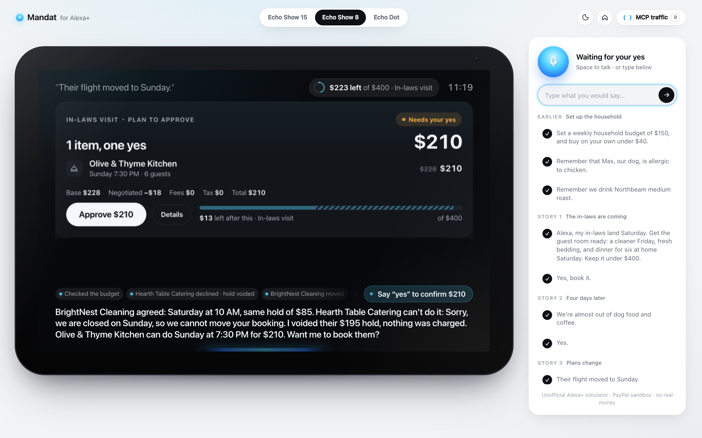
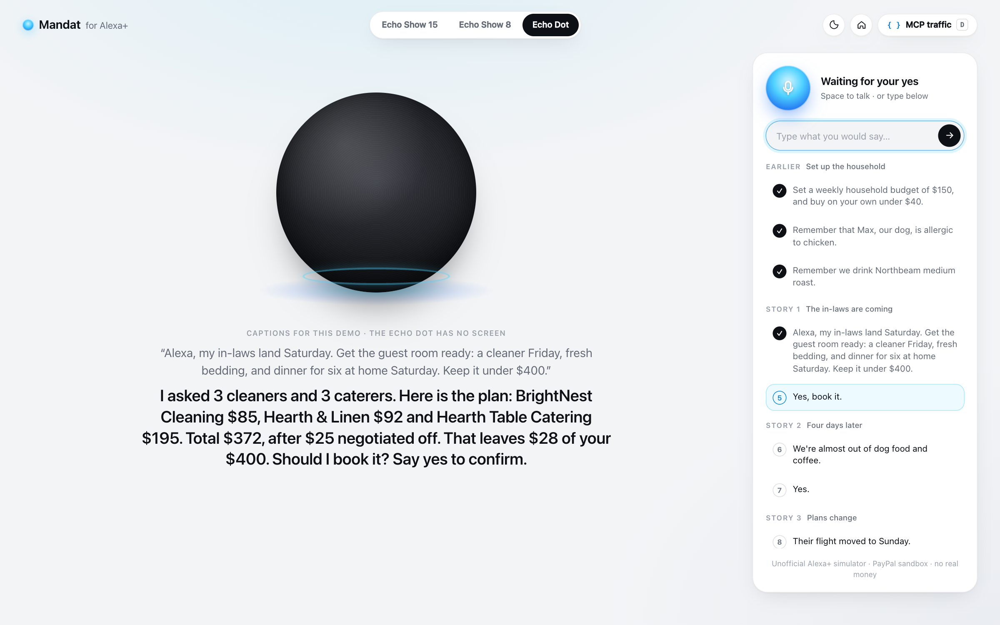
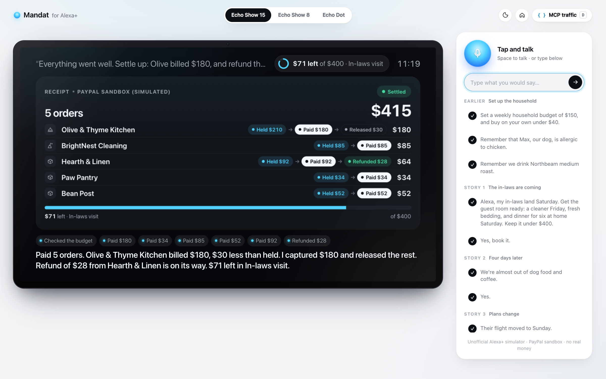

# Mandat for Alexa+

**Give Alexa a budget, not a to-do list.**

Mandat is an Alexa+ add-on for household errands. You set a budget once ("keep it under $400",
"$150 a week, buy on your own under $40"). Mandat asks local merchants' AI agents for quotes in parallel, negotiates,
builds one plan, asks for your yes, places payment holds instead of charging, and remembers the household from one
session to the next. When plans change, it moves, voids, captures less or refunds.

> Hackathon entry for Amazon "Build, Ship, Shape": Alexa+ track, AWS Builder mini-challenge.
> Unofficial Alexa+ simulator. No real money moves: the public demo simulates the payment holds; the PayPal sandbox
> integration (authorize / capture / void / refund) switches on when sandbox keys are set.

## Try it in 2 minutes (judges)

**Live on AWS:** https://fonzkp2f5pszfit6xmqqiw7qdm0dybyu.lambda-url.us-east-1.on.aws/simulator/

1. Open the link in Chrome (desktop). Nothing to install, no account.
2. On the right, click the lines of the demo script in order, or type them, or press Space and talk.
   Each line is one turn: Amazon Nova 2 Lite on Bedrock (a Strands agent) calls the Mandat MCP server, the card on the
   Echo Show is an MCP App, Alexa answers with an Amazon Polly voice. A turn takes about 2 to 15 seconds.
3. Switch **Echo Show 15 / Show 8 / Echo Dot** at the top; press **D** to watch the MCP JSON-RPC traffic.
4. Want a clean start? Add `?household=anything-you-like` to the URL.

**MCP endpoint (any MCP client):** `https://fonzkp2f5pszfit6xmqqiw7qdm0dybyu.lambda-url.us-east-1.on.aws/mcp`
(Streamable HTTP, protocol 2025-11-25), for example:
`npx @modelcontextprotocol/inspector@2.11.0 --cli <that URL> --transport http --method tools/list`

The public demo has a hard model budget and per-address limits; if a limit is reached, Alexa says so and nothing is
booked or charged.


## Three stories

| Story | You say | Mandat does |
|---|---|---|
| **1. The in-laws are coming** | *"My in-laws land Saturday. Get the guest room ready: a cleaner Friday, fresh bedding, and dinner for six at home Saturday. Keep it under $400."* | Asks 3 cleaners and 3 caterers in parallel (signed agent cards checked), finds bedding, builds one plan: **$372, $25 negotiated off, $28 left**. You say *"Yes"*: 3 payment holds, nothing charged yet. |
| **2. Four days later** | *"We're almost out of dog food and coffee."* (new session) | Remembers Max is allergic to chicken (2 products skipped) and your usual coffee. Buys the **$34 dog food on its own** (under your $40 rule), **asks before the $52 coffee**. |
| **3. Plans change** | *"Their flight moved to Sunday."* | The cleaner moves (same hold). The caterer is closed on Sunday: **its $195 hold is voided**, a replacement at $210 is proposed. At the end: Olive billed $180 → **partial capture, $30 released**; $28 pillowcases → **refund**. |

Echo Dot mode (no screen): at most 3 options read, the price breakdown read back, "Say yes to confirm".

| Echo Show 8 | Echo Dot | Receipt timeline |
|---|---|---|
|  |  |  |

## What is in the box

| Part | What it is | Where |
|---|---|---|
| MCP server | MCP **2025-11-25** over **Streamable HTTP** (stateless, JSON responses, Origin check), 10 intent tools + 1 app-only tool | `src/mcp/server.mjs` |
| MCP Apps | 5 cards (`ui://` resources, `text/html;profile=mcp-app`, spec 2026-01-26): status, budget, options carousel, plan, receipt. Theme and size from `hostContext`, auto-fit to the container | `src/ui/` |
| Agent Skill | `mandat-household-errands` (agentskills.io format): money rules, 3 playbooks, voice style; loaded by Strands' `AgentSkills` plugin | `skill/` |
| Alexa+ web simulator | Voice-first page that is itself a real MCP client and MCP Apps host: Echo Show 15 (1920×1080), Echo Show 8 (1280×800), Echo Dot; listening / thinking / speaking / confirming states; JSON-RPC drawer (press **D**) | `simulator/` |
| Orchestrator | Strands Agents (TypeScript) on Amazon Bedrock (**Amazon Nova 2 Lite**), `McpClient` to the server over Streamable HTTP, `AgentSkills` plugin, `ModelRouter` fallback, host guardrails on money tools | `orchestrator/` |
| Household logic | Budgets (envelopes), negotiated quotes, plans, holds, changes, partial capture, refunds | `src/mandat.mjs`, `src/core/` |
| AWS | Lambda (Node 22, arm64) + Function URL, DynamoDB single table, Bedrock (Amazon Nova 2 Lite brain, Amazon Nova Lite merchant agents), Polly neural voice, least-privilege IAM, AWS Budgets alert | `src/lambda.mjs`, `src/store/dynamodb.mjs`, `src/providers/`, `scripts/deploy-aws.sh` |

### Tools

| Tool | Does |
|---|---|
| `get_household_status` | Budgets left, open orders, saved preferences, plans waiting for a yes |
| `set_spending_mandate` | Budget + period + auto-approve rule, one-time PayPal approval |
| `remember_preference` | Allergies, brands, notes, kept across sessions |
| `find_home_services` | Asks every matching merchant agent in parallel, verifies signed agent cards, up to 5 quotes |
| `find_products` | Products filtered by household preferences, usual brand first |
| `negotiate_offer` | One more round with a merchant agent (never below its floor) |
| `propose_plan` | Price breakdown, budget check, auto-approve or "needs your yes", confirmation token |
| `confirm_plan` | PayPal authorization holds, idempotent on the plan |
| `change_order` | New date, time or quantity; a declined change voids the hold and returns replacements |
| `close_order` | Capture (partial: the rest is released), cancel, refund |
| `refresh_card` | App-only (`_meta.ui.visibility: ["app"]`): cards refresh themselves; never shown to the model |

Every result carries `content[0]` (what Alexa says, no ids), `content[1]` (ids for the assistant, "do not read aloud"),
`structuredContent` (rendered by the card) and `_meta.ui` (`resourceUri`, plus the Alexa+ `invoking` / `invoked` texts).

## Run it locally (no account needed)

Requirements: Node.js 22+.

```bash
npm ci
npm test                      # 46 tests: protocol, money rules, guards, the 3 stories, deploy script (no network, no AWS)
npm run demo                  # open http://127.0.0.1:8787/simulator/
```

In the simulator, click the lines of the **demo script** in order (or type / say them; Space = talk in Chrome).
Switch Echo Show 15 / Show 8 / Echo Dot at the top, press **D** for the MCP traffic.

```bash
cd orchestrator && npm ci && npm test      # 11 tests: Strands loop (scripted model), AgentSkills, guardrails, fallback
cd .. && MANDAT_BRAIN=strands npm run demo # same simulator, brain = Strands agent
npm run inspect                            # official MCP Inspector (CLI) battery: 26 checks, answers in docs/inspector/
AWS_PROFILE=<profile> npm run live:scenarios -- 3   # the 3 stories x3 against real Bedrock (about $0.07 a run)
```

Without AWS keys everything runs on local stand-ins: merchant agents answer from their own terms, the Strands agent
uses a scripted model, payments are simulated PayPal calls clearly marked `offline`. Settings: `.env.example` (names only).

### Deploy to AWS (one command)

```bash
DRY_RUN=1 npm run deploy:aws                          # prints every AWS call, calls nothing
AWS_PROFILE=<profile> npm run deploy:aws              # DynamoDB + IAM + Lambda + Function URL + env + smoke test
AWS_PROFILE=<profile> DEPLOY_STAGE=bedrock npm run deploy:aws   # Strands + Amazon Nova brain, Nova merchants, Polly voice
```

Idempotent; settings by environment variable names only (see the header of `scripts/deploy-aws.sh`); PayPal sandbox
keys are read from your shell, never from a file. It works on a brand-new AWS account: no reserved concurrency when
the account's Lambda limit is 10, a hard LLM budget shared by every container (`MANDAT_LLM_BUDGET_USD`, default $15,
one DynamoDB counter) and per-address limits (`MANDAT_LIMIT_TURNS`, `MANDAT_LIMIT_TTS`, `MANDAT_LIMIT_MCP`).

## Architecture

```
Browser: Alexa+ simulator (MCP client + MCP Apps host, Web Speech in, Polly or browser voice out)
   │ 1) MCP Streamable HTTP: initialize / tools/list / resources/read / tools/call (card buttons)
   │ 2) POST /turn ─► orchestrator: Strands agent + AgentSkills on Bedrock, Amazon Nova 2 Lite (or the simulated brain)
   ▼                    │ McpClient (Streamable HTTP)
Mandat MCP server (/mcp, stateless; AWS Lambda + Function URL; locally node :8787)
   ├─ DynamoDB (one table: household, budgets, envelopes, offers, plans, orders, preferences, events)
   ├─ Payments: PayPal sandbox (vault, authorize / capture / void / refund); simulated on the public demo
   ├─ Merchant network (signed agent cards, merchant agents on Amazon Nova Lite, prices and days from each
   │  merchant's own booking rules)
   └─ Products (sandbox catalogue; Channel3 when enabled)
```

## Alexa+ add-on requirements we honour

| Alexa+ guidance | In Mandat |
|---|---|
| Glanceable cards: one title, one or two fields, one action | Each card: one title, one number, one primary action; type sized for the room, auto-fit (no scrolling) |
| Transaction flow: explicit confirmation, price breakdown, no duplicates, cancellation | `propose_plan` breakdown (base, negotiated, fees, tax, total) → yes → `confirm_plan` (token + the user's words, idempotent); void, partial capture, refund |
| Shopping add-ons must protect customers from unintended purchases | Auto-buy only under the household's own rule; above it the server refuses without an explicit yes |
| Voice-only devices: ≤ 5 options, read back, explicit "yes", never mention the screen | Echo Dot mode: 3 options, total read back, "Say yes to confirm" (tested) |
| Voice and screen say the same thing | Card and speech come from the same tool result |
| Keep the user informed when work takes time (latency guidance) | `invoking` / `invoked` texts on every tool, merchant agents asked in parallel, a "what Alexa did" trail on screen |

## Money safety

- Nothing is paid before `confirm_plan`, which needs the token issued for that exact plan.
- Above the household's auto-approve rule, `confirm_plan` also needs the user's explicit yes.
- The budget is checked when the plan is proposed and again when it is confirmed.
- `confirm_plan` is idempotent: a retry returns the same receipt, nothing is held twice.
- A merchant agent's quote is clamped to the merchant's floor and list price, whatever the model says; a day the
  merchant is closed is a decline, whatever the model says.
- The host never lets the model speak for you: `confirm_plan` always receives your exact words of that turn (the model
  tried once to buy the $52 coffee in the same turn; the server refused because you had not said yes), and a budget
  is never created or changed unless you said an amount.
- Under an auto-approve rule each product is its own plan, so a small restock is never hidden behind a big one.

## Before / After

Mandat itself is young: its first commit is dated **1 Oct 2026**, inside this hackathon's submission period
(which opened 31 Aug 2026). It was built as a web app for a payments hackathon. This repository is a new,
separate project that turns it into an Alexa+ add-on. Its first commit (`0f4e29f`, 17 Oct 2026) copies the core
modules unchanged so the diff shows exactly what is new: `git diff 0f4e29f HEAD`.

**Before (Mandat web app, as of 17 Oct 2026)**
- A PWA with its own chat screen, Express server on Render, data mirrored to Cloudflare R2.
- Its own 30-tool agent loop on an OpenAI-compatible model (DeepSeek, then NVIDIA Nemotron on Nebius).
- Restaurants, gifts, scooter repairs, trips: one-off "missions" for one person.
- PayPal Vault + authorize / capture / void / refund, signed merchant agent cards, budget envelopes.

**After (this repository, 17–23 Oct 2026)**
- An **MCP server** (2025-11-25, Streamable HTTP, stateless, Origin check) instead of an app: 10 intent tools designed
  from the Alexa+ tool-schema guidance, plus an app-only tool.
- **5 MCP Apps cards** (`ui://`, `text/html;profile=mcp-app`) built for Echo Show distances, with a hand-written
  host bridge; dark and light; auto-fit to the device.
- An **Agent Skill** (`mandat-household-errands`) and a **Strands Agents** orchestrator on **Amazon Bedrock**.
- A **household** product: recurring budgets with an auto-approve rule, preferences remembered across sessions,
  home-service categories (cleaning, catering, plumbing, handyman) and household products.
- **Change / cancel / refund flows** that follow the Alexa+ transaction guidance: moved bookings keep their hold,
  declined changes void it and propose a replacement, lower final bills capture less and release the rest.
- **Voice-only mode** for Echo Dot.
- **AWS**: Lambda (Node 22) + Function URL, DynamoDB single-table store with conditional writes for idempotency,
  Bedrock (Amazon Nova 2 Lite brain, Amazon Nova Lite merchants), Polly voice, least-privilege IAM, one-command deploy,
  live on a Function URL.
- An **Alexa+ web simulator** (MCP client + MCP Apps host) with device-true Echo Show canvases.
- Removed from the core: the Nebius/OpenAI-compatible LLM client and the R2 store.

Numbers: see `git diff --stat 0f4e29f HEAD`; 57 automated tests, 26 MCP Inspector checks, 3 stories replayed
against real Amazon Bedrock.

## Testing

- `npm test`: 46 tests (MCP protocol surface, MCP Apps resources, every tool, money rules incl. a property test,
  the 3 stories end to end over real HTTP, Echo Dot mode, merchant booking-system guards, per-address limits, the
  shared LLM budget, DynamoDB/Bedrock/Polly request builders, Lambda handler, deploy script against a fake AWS CLI).
- `cd orchestrator && npm test`: 11 tests (Strands strict skill validation, story 1 through Strands, AgentSkills,
  app-only tool filter, host guardrails, Nova defaults and throttling fallback).
- `npm run live:scenarios -- 3`: the 3 stories (11 turns) against **real Amazon Bedrock**. 18 Oct 2026: **33/33 turns
  passed on 3 runs** locally, then **22/22 on 2 runs against the deployed Lambda** (`LIVE_URL=<function URL>`); the
  in-laws plan came to exactly $372 every time. Median turn 5–6 s, slowest 19.7 s (the in-laws request: 6 model calls
  and 6 merchant agents).
- `npm run inspect`: MCP Inspector 2.11 CLI, 26 checks; local results in `docs/inspector/summary.txt`, against the
  live AWS endpoint in `docs/inspector/live-aws/summary.txt` (26/26).
- Screenshots of every state on every device, light and dark: `docs/screenshots/` (the earlier UI is kept in `docs/screenshots/archives/`).

Friction we hit along the way: [FRICTION.md](FRICTION.md).

## Built with

MCP TypeScript SDK 1.32.1 · MCP Apps (spec 2026-01-26) · MCP Inspector 2.11 · Agent Skills · Strands Agents
TypeScript SDK 1.21.0 · Amazon Bedrock (Amazon Nova 2 Lite, Amazon Nova Lite) · AWS Lambda · Amazon DynamoDB ·
Amazon Polly · AWS IAM · AWS Budgets ·
PayPal Server SDK (sandbox) · Node.js 22

## License

MIT, see [LICENSE](LICENSE).
